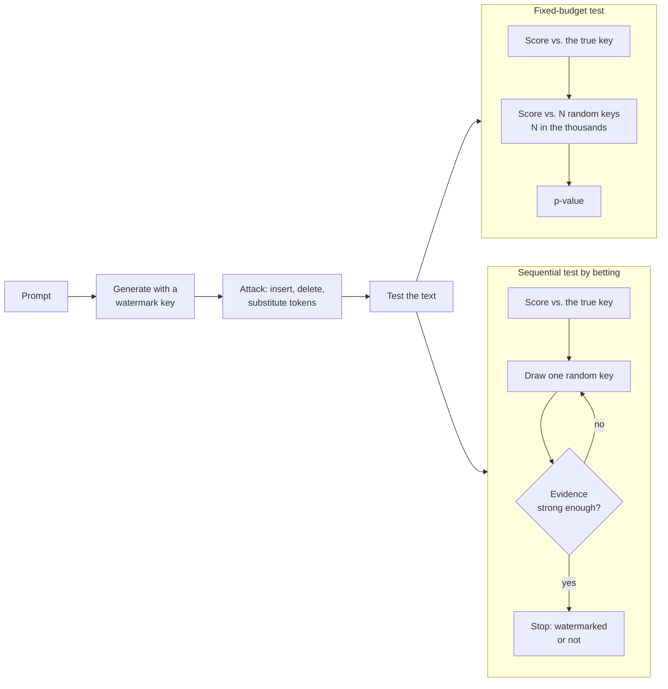

<div align="center">

# Sequential Watermarking of Language Models

**Detect a language-model watermark with far less compute: stop testing as soon as the evidence is clear.**

A sequential Monte Carlo test replaces the fixed-budget permutation test behind distortion-free LLM watermarks, and is measured for detection power, false positives and resampling cost under token edits.

[**Live exhibit →**](https://juyal-devashish.github.io/LLM-Sequential-Watermarking/) &nbsp;·&nbsp; [Final report](reports/Final%20Report.pdf) &nbsp;·&nbsp; [How it works](#how-it-works) &nbsp;·&nbsp; [Run it](#run-it)


</div>

## How it works, in one page

- **The problem:** a distortion-free watermark hides a key in how a model samples tokens. Checking a text for it uses a permutation test: score the text against the true key, then against many random keys. A fixed budget of thousands of resamples is spent on every text, even when the answer is obvious after a few dozen.
- **What this does:** it replaces the fixed budget with a **sequential Monte Carlo test by betting**. Resamples are drawn one at a time, and the test stops as soon as the evidence is strong enough either way, with an anytime-valid false-positive guarantee.
- **What's measured:** detection power, the false-positive rate and the number of resamples needed, across watermarking schemes and under adversarial token insertions, deletions and substitutions.

> [!NOTE]
> **A University of Michigan CSE 598 (Winter 2025) group project, forked from [the group repository](https://github.com/emiliocantuc/watermark-sequential).** The watermark implementations build on [Kuditipudi et al.](https://github.com/jthickstun/watermark). Project-level work is collaborative; individual contributions are recorded in the final report. The research code still has open validation work, listed in [docs/VALIDATION.md](docs/VALIDATION.md).

---

## How it works



1. **Generation.** Text is generated with a watermark key, using one of the implemented schemes.
2. **Attacks.** Tokens are inserted, deleted or substituted at controlled rates, to test robustness.
3. **Detection.** The fixed permutation test and the sequential test both score the text; the sequential test stops early once its wealth process crosses the threshold or the evidence runs out.
4. **Evaluation.** Experiments on C4 and instruction prompts sweep attack strength and record power, false positives and resamples used.

## Features

- **Distortion-free watermarks** under `src/watermarking/`: Gumbel-max and inverse-transform sampling, each with a Cython Levenshtein alignment for edit-robust scoring. The runners also support a Kirchenbauer green-list baseline, but its `watermark_processor` module isn't in this checkout yet (only its homoglyph data is).
- **Detection** with the fixed permutation test and the sequential Monte Carlo test by betting (`--test sequential_mc`).
- **Attacks** for insertion, deletion and substitution at configurable rates.
- **Experiment runners** for C4 and instruction prompts, with sweep scripts in `experiments/scripts/`.
- **An interactive exhibit** with a labeled teaching simulation of the sequential test, built from `frontend/` and deployed to GitHub Pages.
- **An evidence trail:** the original reports and slides, an evidence inventory ([docs/EVIDENCE.md](docs/EVIDENCE.md)) and a validation backlog.

## Reports and evidence

| Document | What's in it |
|---|---|
| [Final report](reports/Final%20Report.pdf) | Method, experiments, results and individual contributions |
| [Midterm report](reports/Midterm%20Report.pdf) and [slides](reports/Project%20Slides.pdf) | The project as presented |
| [Additional write-up](https://drive.google.com/file/d/1KNR2OcLC9Ueuu13OQ-wDDC5eKqOUWkYq/view) | Supplied by the author |
| [docs/EVIDENCE.md](docs/EVIDENCE.md) | Which saved results support which claims |
| [docs/VALIDATION.md](docs/VALIDATION.md) | Open validation work |

Saved figures in `results/figures/` are historical results. The current checkout has no raw per-trial files or saved detection traces, so no new performance claim follows from this repository's cleanup.

## Run it

**Prerequisites:** Python 3.11 and a C compiler for the Cython alignment modules. PyTorch uses CUDA when available and the CPU otherwise.

```bash
git clone https://github.com/juyal-devashish/LLM-Sequential-Watermarking.git && cd LLM-Sequential-Watermarking
python3.11 -m venv .venv && source .venv/bin/activate
python -m pip install -e '.[experiments,analysis]'
```

```bash
python -m experiments.c4_experiment --help
python -m experiments.instruct_experiment --help
python -m experiments.analyze --help
```

A small sequential run on C4 (it downloads the model and dataset; slow on CPU):

```bash
mkdir -p results/raw/smoke
python -m experiments.c4_experiment \
  --save results/raw/smoke/sequential.p \
  --model facebook/opt-1.3b --test sequential_mc \
  --T 2 --batch_size 1 --m 20 --n_runs 100
```

**Exhibit:** `node frontend/build.mjs` assembles the site in `frontend/dist/`; serve it with any static server. GitHub Actions deploys it on pushes to `main`.

## Repository layout

| Location | Contents |
|---|---|
| `src/watermarking/` | Generation, detection, attacks, the Gumbel and transform methods, and Kirchenbauer homoglyph data |
| `experiments/` | C4 and instruction runners, sweeps and instruction inputs |
| `examples/legacy_demo/` | Original standalone Python and JavaScript demos |
| `notebooks/` | Exploratory analysis with historical outputs |
| `results/figures/` | The original saved project plots |
| `reports/` | Midterm report, final report and slides |
| `environments/` | The historical Linux/CUDA Conda export (don't use on macOS) |
| `docs/` | Architecture, evidence inventory, validation work, exhibit plan |
| `frontend/` | Static exhibit, teaching simulation and build script |

Renamed paths are mapped in [docs/REPOSITORY_LAYOUT.md](docs/REPOSITORY_LAYOUT.md).

## References

- Kuditipudi et al., [Robust Distortion-free Watermarks for Language Models](https://arxiv.org/abs/2307.15593).
- Fischer and Ramdas, [Sequential Monte-Carlo Testing by Betting](https://arxiv.org/abs/2401.07365).

Upstream attribution and notices in the source are retained. This repository assigns no new license to inherited code.
